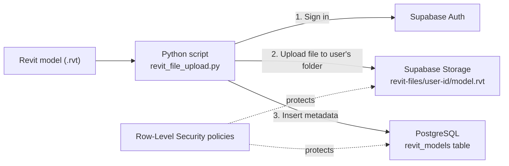

# BIM Automation Library

**A lightweight Common Data Environment (CDE) for Autodesk Revit models, built with Python, Supabase (PostgreSQL) and pyRevit. Each user can only see and change their own models and files, and automated tests prove it.**


---

## Why This Project Exists

On building projects, Revit models are often shared through email, shared drives or chat. That makes it hard to answer basic questions: *Who uploaded this model? Is this the latest version? Who is allowed to see it?*

**ISO 19650**, the international standard for managing building information with BIM, answers this with a **Common Data Environment**: one controlled place where models are stored, tracked and shared with the right people.

This project builds a small CDE step by step, focusing on the parts that matter most:

- **Controlled storage** for native Revit (`.rvt`) files
- **Metadata tracking** for every model (project, status, last updated, owner)
- **Per-user access control** enforced by the database itself, not just the app
- **A roadmap** toward ISO 19650 concepts: naming conventions, CDE states (WIP → Shared → Published → Archived), revision codes and an audit trail

---

## What It Does Today

| Feature | How it works |
|---|---|
| **Upload Revit models to the cloud** | A Python script reads the `.rvt` file as binary data and uploads it to a Supabase Storage bucket |
| **Track each model in a database** | The same script inserts a row into a PostgreSQL table (`revit_models`) with project name, storage path, status and timestamp |
| **User sign-in** | Scripts sign in through Supabase Auth; credentials come from environment variables, never from code |
| **Per-user database security** | Row-Level Security (RLS) policies on `revit_models`: users can only read, add, change or delete **their own** rows |
| **Per-user file security** | Storage policies: each user's files live in a folder named after their user ID, and users can only access their own folder |
| **Automatic ownership** | The `owner_id` column defaults to the signed-in user (`auth.uid()`), so ownership can't be skipped or faked |
| **Automated security tests** | `test_rls.py` proves the owner can see their data, another user sees nothing, and anonymous writes are rejected |
| **pyRevit playbook** | Reusable Revit API snippets (element collectors, starter template) for building Revit-side tools |

---

## How It Works



1. **Sign in.** The script signs in as a user and receives a session token.
2. **Upload.** The model is uploaded to `revit-files/<user-id>/<file-name>`. A storage policy only allows uploads into the signed-in user's own folder.
3. **Record.** A row is added to `revit_models`. The database fills in `owner_id` automatically, and an RLS policy checks it matches the signed-in user.

---

## Security Model

Security is enforced **in the database** with PostgreSQL Row-Level Security, so it applies to every client: scripts, future pyRevit tools and future dashboards.

### Table policies (`revit_models`)
| Action | Rule |
|---|---|
| Read | `auth.uid() = owner_id` |
| Insert | New row must have `owner_id = auth.uid()` |
| Update | Only your rows, and you can't hand a row to someone else |
| Delete | Only your rows |

### Storage policies (`storage.objects`, bucket `revit-files`)
| Action | Rule |
|---|---|
| Upload / read / update / delete | The file's first folder must equal the signed-in user's ID |

### Test results
```text
$ python test_rls.py
Test 1 - User A sees 4 rows (expected: more than 0)
Test 2 - User B sees 0 rows (expected: 0)
Test 3 - Blocked as expected: {'message': 'new row violates row-level security policy for table "revit_models"', 'code': '42501', ...}
```

### Other practices
- Secrets live in a git-ignored `.env` file; `.env.example` documents the required settings with placeholder values.
- API keys were rotated after an early configuration mistake, and the repository now ignores all environment files.
- The scripts use the **publishable** key only, which respects RLS. The secret key, which bypasses RLS, is never used in client code.
- All database changes are recorded as SQL in [`SQL/Phase7_rls.sql`](pyRevit_Supabase_projects/SQL/Phase7_rls.sql), with comments explaining each step.
- Work happens on feature branches and is merged through pull requests.

---

## Tech Stack

| Area | Tools |
|---|---|
| Language | Python 3 |
| Backend | Supabase: PostgreSQL, Auth, Storage |
| Security | PostgreSQL Row-Level Security, storage policies |
| BIM | Autodesk Revit, pyRevit, Revit API |
| Libraries | `supabase`, `python-dotenv` |
| Workflow | Git, GitHub (issues, project board, pull requests), VS Code |

---

## Repository Structure

```text
BIM-Automation-Library/
├── pyRevit_Playbook/                 # Revit API snippets for pyRevit tools
│   ├── starterTemplate.py            # Boilerplate for new pyRevit scripts
│   └── filteredElementCollectors.py  # Common ways to collect Revit elements
│
└── pyRevit_Supabase_projects/        # The CDE project
    ├── revit_file_upload.py          # Sign in → upload .rvt → record metadata
    ├── test_rls.py                   # Security tests (owner / other user / anonymous)
    ├── SQL/
    │   └── Phase7_rls.sql            # owner_id column + table and storage policies
    ├── models/                       # Autodesk sample Revit model for testing
    ├── .env.example                  # Required settings (placeholders only)
    └── .gitignore                    # Keeps .env and Python caches out of git
```

---

## Getting Started

### Prerequisites
- Python 3
- A free [Supabase](https://supabase.com) project
- Two test users created in **Supabase → Authentication → Users**

### 1. Install the libraries
```bash
pip install supabase python-dotenv
```

### 2. Configure settings
Copy `.env.example` to `.env` in `pyRevit_Supabase_projects/` and fill in your own values:
```text
SUPABASE_URL=https://your-project-ref.supabase.co
SUPABASE_KEY=sb_publishable_your_key_here
SUPABASE_EMAIL=your-test-user@example.com
SUPABASE_PASSWORD=your-password-here
SUPABASE_EMAIL_B=second-test-user@example.com
SUPABASE_PASSWORD_B=your-password-here
```

### 3. Set up the database
- Create a `revit_models` table (`project_name`, `storage_path`, `last_updated`, `status`) and a storage bucket named `revit-files`.
- Run the statements in `SQL/Phase7_rls.sql` in the Supabase **SQL Editor**. Replace the example user ID in Step 3 with one of your own users.

### 4. Run
```bash
cd pyRevit_Supabase_projects
```
```bash
python revit_file_upload.py
```
```bash
python test_rls.py
```
Update `LOCAL_FILE_PATH` in `revit_file_upload.py` to point to a Revit file on your machine.

---

## Roadmap

Progress is tracked on GitHub [issues](https://github.com/bvoltz/BIM-Automation-Library/issues) and a project board.

| Phase | Focus | Status |
|---|---|---|
| 1 | Foundation: Python environment, Supabase table, first insert | ✅ Done |
| 4 | File storage: upload `.rvt` files, store location in the database | ✅ Core working |
| 7 | **Per-user Row-Level Security** for data and files, with tests | ✅ Done |
| 2 | Core automation: batch-process a folder of models, status tracking, filters | 🔜 Planned |
| 3 | pyRevit integration: a "Publish to CDE" button and sign-in window inside Revit | 🔜 Planned |
| 5 | Dashboard and reporting: Power BI or a Flask web app | 🔜 Planned |
| 6 | **ISO 19650 governance**: file naming validation, CDE states, suitability and revision codes | 🔜 Planned |
| 8 | Secure storage: private bucket and expiring signed links | 🔜 Planned |
| 9 | Audit trail and version history: who changed what and when, with every version kept | 🔜 Planned |
| 10 | Reliability: pinned dependencies, retries, error handling, automated tests | 🔜 Planned |

---

## What I Learned

- **Security belongs in the database.** RLS protects data no matter which app or script connects.
- **Test that the wrong people are blocked,** not just that the right people get in.
- **Storage has its own rules.** File access needed separate policies from the table.
- **Secrets management matters from the first commit:** `.gitignore`, `.env.example`, key rotation.
- **Record database changes as code** so the setup can be reviewed, repeated and taught.

---

## Author

Built by [@bvoltz](https://github.com/bvoltz) as part of a hands-on journey into BIM automation, cloud data environments and, in the future, digital twins.

*The sample model in `models/` is an Autodesk Revit sample project, used for testing only.*
